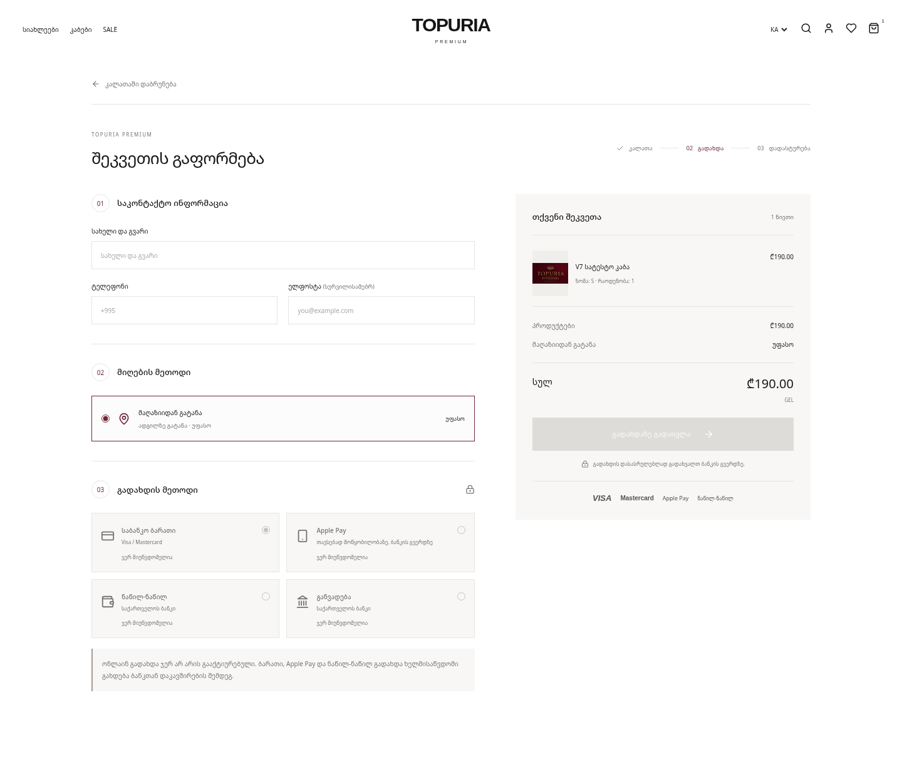
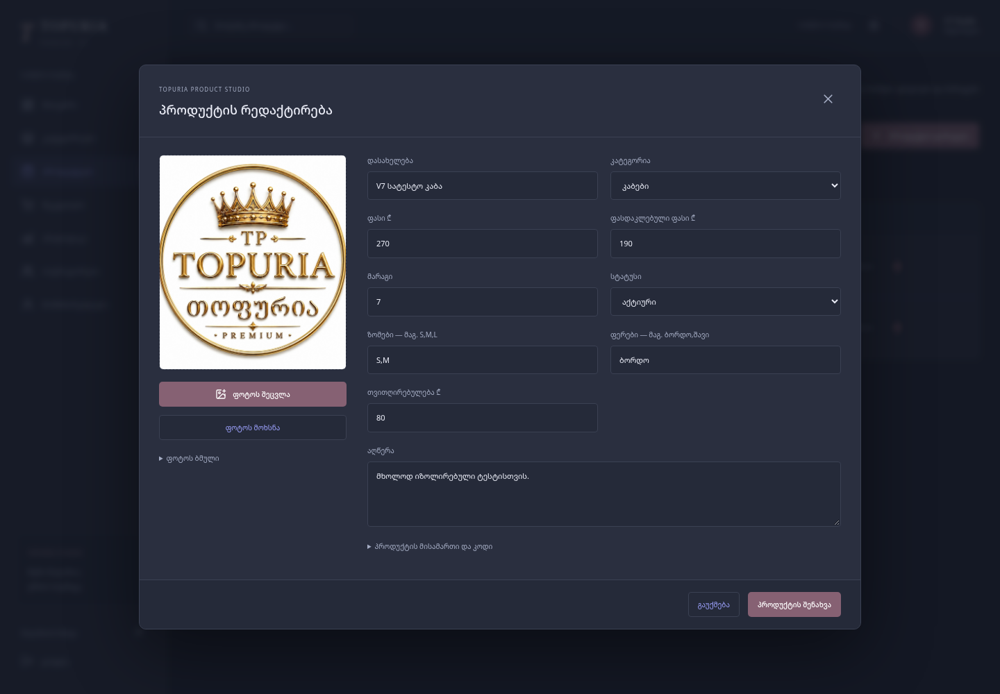

# Topuria Premium V7 — ცვლილებები და Vercel

## განახლება: BOG checkout

დაემატა თანამედროვე გადახდის გვერდი, BOG-ის hosted Visa/Mastercard, Apple Pay,
„ნაწილ-ნაწილ“ და განვადების კოდი. ბანკის merchant წვდომის მიღებამდე ღილაკები
გათიშულია და არც შეკვეთა იქმნება, არც მარაგი იცვლება.
გადახდის დასრულებას მხოლოდ სერვერზე ბანკის receipt ადასტურებს.
მარაგი ტრანზაქციით რეზერვდება; დუბლირებული მოთხოვნები/შეტყობინებები მეორედ არ ცვლის მას.
ადმინში გადახდის სტატუსი მიწოდებისგან განცალკევებულია და მოძველებული მარაგის შენახვა იბლოკება.

ჩართვის ზუსტი ნაბიჯები: [BOG-PAYMENTS.md](docs/BOG-PAYMENTS.md).
საჭიროა ერთჯერადი, მხოლოდ დამატებითი Payment ცხრილი და ჯერ იზოლირებული Sandbox შემოწმება.
Production ბაზაზე ცვლილებები ან ნამდვილი საბანკო გადახდა ამ სამუშაოს დროს არ შესრულებულა.
ქალაქობრივი კურიერის/ფოსტის ტარიფები მომხმარებელმა შემდეგ ეტაპზე გადადო.



## განახლება: პირდაპირი კატალოგი და პროდუქტების რედაქტორი

მომხმარებლის Situationist-ის რეფერენსისა და მოთხოვნის შესაბამისად, მთავარი გვერდი
ახლა პირდაპირ პროდუქტების კატალოგია: სამი სვეტი desktop-ზე, ორი მობილურზე,
მოკლე ნავიგაცია, დიდი ფოტოები, სახელი/ფასი და ფილტრები გვერდით პანელში.
დიდი hero, სარეკლამო editorial ბლოკები და slogan-ები მთავარიდან ამოღებულია.
ბრენდი და პროდუქტის ფოტოები რჩება Topuria-სი; სხვა საიტის კონტენტი არ დაკოპირებულა.

პროდუქტების გვერდი ახლა სამუშაო სია/ბარათებია. სახელზე, ფასზე ან მარაგზე დაჭერით
იხსნება ერთი რედაქტორი. ფოტო, ფასი, მარაგი, კატეგორია, ზომები და სტატუსი ერთად ინახება.
ახალი პროდუქტის SKU და მისამართი ავტომატურად იქმნება, თუ ხელით არ შეავსეთ.
არსებული პროდუქტის უცნობი ძველი კატეგორია არ ბლოკავს ფასის/მარაგის რედაქტირებას.
Cloudinary ატვირთვა შესრულდება ფაილის არჩევით, არსებული ავტორიზებული signing endpoint-ით;
საიდუმლო Cloudinary API Secret კვლავ მხოლოდ სერვერზე რჩება.
ატვირთვის შემდეგ პროდუქტის შენახვის საჭიროება მკაფიოდ ჩანს.
შეცდომები რედაქტორშივე ჩანს, წარმატება — პროდუქტების სიაში.

კატეგორიაზე დაემატა სახელის, აღწერის, რიგითობისა და აქტიურობის რედაქტირება.
არსებული slug უცვლელია, რათა პროდუქტების კავშირი არ დაზიანდეს.
ოპერატორებზე შესაძლებელია ანგარიშის დამატება, სახელის/ელფოსტის შეცვლა და სურვილისამებრ
პაროლის განახლება; ცარიელი პაროლი არსებულ passwordHash-ს უცვლელად ტოვებს.
შეკვეთებზე გამოჩნდა სრული დეტალები, ძებნა/ფილტრი და მიწოდების მონაცემების რედაქტირება.
თანხა და შეკვეთის პროდუქტები ამ ფორმით არ იცვლება.

შემოწმება: TypeScript, production build, ექვსი ინტეგრაციის ტესტი და browser CRUD/მობილური შემოწმებები.
გარე Cloudinary ფაილის ატვირთვა ბრაუზერის ტესტში mock პასუხით მოწმდება;
რეალური Cloudinary upload ცოცხალ გარემოში კვლავ შესამოწმებელია.
ყველა საცდელი ჩანაწერი მხოლოდ იზოლირებულ local PostgreSQL-ში შეიქმნა.
ნამდვილი Neon-ის ჩანაწერები და სქემა არ შეცვლილა.
ცოცხალი Vercel საიტის ნახვა ამ გარემოს ქსელმა 403 პასუხით დაბლოკა — მისი ფუნქციონირება აქედან არ დადასტურებულა.

### პროდუქტის რედაქტორის ხედი

ქვემოთ მხოლოდ იზოლირებული ტესტის მონაცემებია, არა ცოცხალი მაღაზიის ჩანაწერები.



## ფოტოების შემცირების ეტაპი

ახალი ატვირთვისას ფოტო მუშავდება მომხმარებლის ბრაუზერში: მაქსიმალური გვერდი
1600px, WebP შეკუმშვა და დაახლოებით 400KB სამიზნე მოცულობა.
უკვე პატარა ფოტო დამატებით არ მძიმდება. არსებული Cloudinary ორიგინალები არ წაშლილა;
ახალი შემცირება მხოლოდ შემდგომ ატვირთვებზე მუშაობს.
სატესტო 2,017,296-ბაიტიანი PNG ატვირთვამდე შემცირდა 135,264 ბაიტამდე.
რეალური ატვირთვის ქსელი ტესტში ჩანაცვლებული იყო პასუხით; სურათის დამუშავება და
გამავალი ფაილის ზომა/განზომილებები რეალურად გადამოწმდა.

Desktop კატალოგი ახლა ოთხ სვეტს აჩვენებს მაქსიმუმ 1320px კონტეინერში,
ტაბლეტი — სამს, მობილური — ორს. დეტალური ფოტო შეზღუდულია 560px სიმაღლით
(მობილურზე 430px) და ტანსაცმელს არ ჭრის.

ფოტოების ეტაპს შემდეგ დაემატა BOG checkout-ის კოდი, აღწერილი ამ დოკუმენტის დასაწყისში.
ბანკში კვლავ საჭიროა ონლაინ გადახდების მომსახურებისა და API/Sandbox წვდომის გააქტიურება;
ჩვეულებრივი Vercel deploy ამ მოთხოვნას არ ცვლის.

## რა იყო პრობლემა

- ადმინი Prisma-ში ინახავდა პროდუქტებს, storefront კი `app/data.ts`-ის ოთხ სატესტო პროდუქტს იყენებდა.
- ნამდვილი `imageUrl`, ფასდაკლება, ზომები და მარაგი საჯარო კატალოგამდე არ მიდიოდა.
- კატეგორიების მენიუ ცალკე, სტატიკურად იყო დაწერილი.
- `AnalyticsEvent` არსებობდა, მაგრამ გვერდის ნახვები და კალათაში დამატებები სრულად არ იწერებოდა.
- მომხმარებლის ანგარიშის გვერდი დემო წარმატებას აჩვენებდა; checkout ღილაკს backend არ ჰქონდა.
- Google Fonts-ის ჩამოტვირთვა ამ გარემოში production build-ს აფერხებდა.
- ზოგი API პასუხი ოპერატორს თვითღირებულებას ან უფლებების განახლებისას პაროლის hash-ს უბრუნებდა.
- `.env` Git-ში იყო ატვირთული.

## რა შეიცვალა

- მუქი, Skote-ის რეფერენსით შთაგონებული ადმინი: გვერდითი მენიუ, ზედა ძებნა, KPI ბარათები,
  გაყიდვების გრაფიკი, 7/30/90-დღიანი პერიოდები, მარაგი, წყაროები და ბოლო შეკვეთების ცხრილი.
- დამოუკიდებელი ნათელი რეჟიმი და მობილური მენიუ; storefront-ის ძველი ენისა და თემის არჩევანი შენარჩუნებულია.
- მინიმალისტური storefront, ქართული ლოკალური ფონტები, ბორდოს მცირე აქცენტები და რეალური პროდუქტის ფოტოები.
- მთავარი, კატალოგი, ძებნა, რჩეულები, კალათა და დეტალური გვერდი ერთ `getPublicCatalog`-ს იყენებს.
- მხოლოდ ACTIVE პროდუქტები ჩანს. გამორთული კატეგორიის პროდუქტები იმალება;
  ძველი კატეგორიის სტრიქონები, რომელთა Category ჩანაწერი ჯერ არ არსებობს, შენარჩუნებულია.
- ფასდაკლება, მარაგი, აღწერა, ფერები და ზომები ბაზიდან მოდის. ფასი რჩება V6-ის მთლიან ლარებში.
- Cloudinary და ადგილობრივი ფოტოები Next Image-ით ოპტიმიზდება; სხვა არსებული HTTPS ჰოსტებისთვის რჩება პირდაპირი გამოსახულება.
- წარმოებისას გვერდები დინამიკურია. ახალ ვიზიტზე პროდუქტები თავიდან იკითხება;
  გახსნილ storefront-ზე მონაცემები ნავიგაციისას ან ფანჯარაში დაბრუნებისას განახლდება.
  ფონურ real-time გამოწერას ეს ვერსია არ იყენებს.
- ყველა მომხმარებლის მოქმედება იგზავნება იმავე origin-ის ანალიტიკის endpoint-ზე; ადმინის ვიზიტები არ ითვლება.
- სესიები browser sessionStorage-ის UUID-ით ითვლება და ადამიანების უნიკალურ რაოდენობას არ ნიშნავს.
- „ჩაბარებული გაყიდვები“ მხოლოდ DELIVERED შეკვეთებიდან ითვლება.
  გრაფიკის თარიღი შეკვეთის შექმნის თარიღია, რადგან ჩაბარების დრო არსებულ სქემაში არ ინახება.
- მოგება ითვლის მხოლოდ ჩაბარებული შეკვეთების შემოსავალსა და მათ OrderItem-ის შენახულ თვითღირებულებას.
- გაუქმებული შეკვეთები გამორიცხულია გაყიდვებიდან. მომხმარებლის სესია შეკვეთას სქემაში არ უკავშირდება,
  ამიტომ გაყიდვის ზუსტ session-to-order კონვერსიას არ ვიგონებთ.
- საიდუმლო ფასები და passwordHash აღარ გადადის შეუსაბამო API პასუხებში.
  Origin შემოწმება დაემატა ადმინის ცვლილებებს; JWT cookie და არსებული ავტორიზაცია შენარჩუნებულია.
- `setup` მხოლოდ Prisma Client-ს აგენერირებს. ის აღარ ცვლის სქემას და აღარ ასრულებს seed-ს.
- Prisma-ს კონფიგურაციის ორი ტრანზიტული დამოკიდებულება განახლდა overrides-ით:
  deepmerge-ts 8.0.0 და effect 3.20.0. ამ კომბინაციაზე გენერაცია, build და ინტეგრაცია შემოწმებულია.
- `.env` Git-ის თვალთვალიდან ამოღებულია, ადგილობრივი ასლი შენარჩუნებულია.

არსებული მონაცემები, პაროლები და ადმინისტრატორის უფლებები ავტომატურად არ შეცვლილა.
ძველი სქემა შენარჩუნებულია; ონლაინ გადახდის ჩასართავად ახალი Payment ცხრილი ცალკე ემატება.
ძველად დამატებული სატესტო ჩანაწერებიც არ წაშლილა — მონაცემებს თვითნებურად არ ვშლით.

## არსებული მონაცემების უსაფრთხოება

ახალ deploy-ზე არ გაუშვა `db:seed`, `prisma db seed`, ძველი `setup`,
`db:push`, reset ან ავტომატური სქემის მიგრაცია. გადახდა გათიშული რჩება, სანამ
განხილული დამატებითი Payment SQL ცალკე არ შესრულდება და ბანკი არ გააქტიურდება.

თუ GitHub-ზე ატვირთული `.env` ნამდვილ მონაცემებს შეიცავდა, შეცვალე Neon-ის პაროლი,
Cloudinary-ის საიდუმლო გასაღები და AUTH_SECRET შესაბამის სერვისებში.
Git-ის თვალთვალიდან ამოღება ძველი commit-ებიდან ფაილს არ შლის.
AUTH_SECRET-ის ცვლილება არსებულ სესიებს გააუქმებს; ანგარიშები და პაროლის hash-ები უცვლელი რჩება.

## Vercel-ზე ატვირთვა

1. ატვირთე V7-ის საწყისი ფაილები GitHub-ზე იმავე საქაღალდის სტრუქტურით.
   `package.json` პროექტის მთავარ დონეზე უნდა იყოს. არ ატვირთო `.env`, `.next` ან `node_modules`.
2. Vercel-ში აირჩიე **Add New → Project** და დააკავშირე შესაბამისი GitHub რეპოზიტორია.
3. Framework: **Next.js**. Root Directory: `package.json`-ის საქაღალდე.
   Node.js: **24.x**. Install Command: `npm ci`. Build Command: `npm run build`.
   Output Directory დატოვე Next.js-ის ნაგულისხმევ რეჟიმში.
4. **Settings → Environment Variables**-ში უსაფრთხოდ შეავსე:

| სახელი | დანიშნულება |
| --- | --- |
| DATABASE_URL | Neon-ის PostgreSQL pooled URL, TLS/sslmode=require-ით |
| AUTH_SECRET | არსებული ძლიერი სესიის საიდუმლო, ან ახალი თუ ძველი გამჟღავნდა |
| NEXT_PUBLIC_CLOUDINARY_CLOUD_NAME | Cloudinary-ის საჯარო cloud name |
| NEXT_PUBLIC_CLOUDINARY_API_KEY | ატვირთვის widget-ის საჯარო API key |
| CLOUDINARY_API_KEY | სერვერის API key |
| CLOUDINARY_API_SECRET | მხოლოდ სერვერის საიდუმლო; არასოდეს NEXT_PUBLIC_ |

5. Preview გარემოსთვის სასურველია Neon-ის ცალკე branch, რომ ტესტებმა production ჩანაწერები არ შეცვალოს.
   არ ჩაწერო საიდუმლო მნიშვნელობები README-ში ან ჩათში.
6. გაუშვი Deploy. საჯარო Cloudinary ცვლადების შეცვლის შემდეგ თავიდან გაუშვი deploy —
   Next.js მათ build-ის დროს ინახავს.
7. რეალურ გარემოში შეამოწმე არსებული admin login, signed photo upload, პროდუქტის შენახვა,
   storefront-ზე მისი გამოჩენა და სტატუსის/მარაგის განახლება.
   არ შექმნა სატესტო შეკვეთები production ბაზაში მხოლოდ შემოწმების გამო.

`vercel.json` საჭირო არ არის. Vercel Next.js-ს ავტომატურად მართავს.
Vercel დაკავშირებულია GitHub-ის `main` branch-თან. ახალი ცვლილებები ცალკე branch/PR-ით გადადის;
merge-ის შემდეგ Vercel იწყებს build/deploy-ს. შედეგი გადაამოწმეთ Deployments-ში — `Ready`.
ეს ბანკის მეთოდებს ან ბაზის სქემას ავტომატურად არ ააქტიურებს.

## ლოკალური გაშვება

გამოიყენე არსებული checkout — თითოეული cloud task უკვე იზოლირებულია; worktree-ის შექმნა საჭირო არ არის.

```sh
npm ci
npm run typecheck
npm run build
npm run dev
```

თუ Prisma engine-ის ჩამოტვირთვა პროქსის გამო 403-ით უარყოფილია:

```sh
bash scripts/prepare-cloud.sh
```

ეს სკრიპტი cloud გარემოს `/workspace/Free` checkout-ს იყენებს,
აყენებს lockfile-ის დამოკიდებულებებს, ოფიციალურ engines-ს ჩამოტვირთავს,
ორივე SHA256-ს ამოწმებს, ასრულებს postinstall ნაბიჯებს და აგენერირებს Prisma Client-ს.
მონაცემთა ბაზის ჩანაწერებს არ ცვლის.

## შემოწმება და მისი საზღვრები

- TypeScript და production build: წარმატებული.
- ინტეგრაციის 9 ტესტი: წარმატებული იზოლირებულ PostgreSQL-ში.
  შემოწმდა admin create/update → საჯარო კატალოგი, მონაცემების დამალვა, უფლებები,
  origin-ის დაცვა, ფოტოების signing-ის წარმატებული და უარყოფითი სცენარები და რეალური DB ანალიტიკის დათვლა.
- checkout-ის 28 ტესტი ნამდვილ local PostgreSQL-ში და ბანკის adapter/config-ის 13 mock ტესტი: წარმატებული.
  ერთჯერადი Payment SQL-იც შემოწმდა legacy სქემაზე: პროდუქტი/ნაშთი/შეკვეთა/პოზიციები შენარჩუნდა.
- Playwright: desktop/მობილური login, თემები, გრაფიკი, ძებნა, სორტირება, რჩეულები,
  კალათა და 320/390px განლაგება.
- Checkout Playwright: მეთოდების გამორთული მდგომარეობა, ფასის კონფლიქტის შემდეგ აღდგენა,
  იგივე მცდელობის გამეორება, ბანკის დადასტურებამდე pending, შეძენილი რაოდენობის მხოლოდ ერთხელ
  გამოკლება კალათიდან და საკუთარი ჯავშნის შემდეგ გადახდის გაგრძელება.
  საბანკო პასუხები ბრაუზერის შიგნითაა mock-ით ჩანაცვლებული; ეს საბანკო ტესტის შემცვლელი არ არის.
- ნამდვილი Neon ამ cloud გარემოში ვერ იკითხება: გარე PostgreSQL-ის hostname DNS-ით ვერ იხსნება (P1001).
  იგივე გარემოში სხვა გარე DNS სახელებიც ვერ იხსნება; HTTP პროქსი მუშაობს.
  ამიტომ Vercel-ის Neon კავშირი ცალკე უნდა შემოწმდეს. ახალი secret-ის აუცილებლობა ამით არ დასტურდება.
- Cloudinary-ზე რეალური ატვირთვა არ შესრულებულა. შენარჩუნებულია signed admin upload გზა;
  live upload-ს რეალურ გარემოში ვამოწმებთ.
- სატესტო მონაცემები მხოლოდ `127.0.0.1`-ზე არსებულ `topuria_v7_test` ბაზაში იქმნება და შემდეგ იშლება.
  ტესტები სხვა hostname-ს ან სხვა ბაზის სახელს უარყოფს.
  სქრინშოტებშიც იზოლირებული fixture მონაცემებია, არა შენი Neon-ის ჩანაწერები.
- მომხმარებლის backend login ჯერ მიუწვდომელია. BOG checkout-ის კოდი დამატებულია;
  მისი გააქტიურება მოითხოვს ბანკის წვდომას, SQL-ის შესრულებას და საბანკო ტესტირებას.
- მაღალი ტრაფიკისთვის login/tracking-ის თითო-instance rate limiter უნდა შეიცვალოს საერთო საცავით.
  ეს ვერსია მრავალი Vercel instance-ისთვის საერთო rate limit-ს არ ამტკიცებს.

სრული საჯარო გაყიდვების გაშვებას ჯერ სჭირდება live Neon/Cloudinary შემოწმება,
BOG-ის გააქტიურება/საბანკო ტესტი და მიღების/მიწოდების საბოლოო წესები.

## იზოლირებული ინტეგრაციის ტესტები

ეს ბრძანებები გამოიყენე მხოლოდ ცარიელ, დროებით local PostgreSQL ბაზასთან:

```sh
# 1. შექმენი ცარიელი topuria_v7_test ბაზა 127.0.0.1-ზე.
# 2. DATABASE_URL მიმართე მხოლოდ ამ ბაზაზე და დააყენე სქემა:
DATABASE_URL="$TEST_DATABASE_URL" npm exec -- prisma db push --skip-generate

# 3. production build-ის შემდეგ გაუშვი სატესტო სერვერი ცალკე terminal-ში:
DATABASE_URL="$TEST_DATABASE_URL" AUTH_SECRET="local-validation-only-secret" \
CLOUDINARY_API_KEY="local-test-key" CLOUDINARY_API_SECRET="local-test-signing-secret" \
NEXT_PUBLIC_CLOUDINARY_CLOUD_NAME="local-test-cloud" npm start

# 4. ტესტი შეამოწმებს localhost-სა და ბაზის სახელს fixtures-ის შექმნამდე:
npm run test:integration
```

TEST_DATABASE_URL უნდა იყოს local `topuria_v7_test` კავშირი.
არ გამოიყენო production DATABASE_URL ტესტებისთვის.
ბრაუზერის დამატებითი შემოწმება მოითხოვს Python Playwright-სა და Chromium-ს:

```sh
npm exec -- tsx tests/browser-fixtures.ts
python tests/browser-smoke.py
npm exec -- tsx tests/browser-fixtures.ts --clean
```
